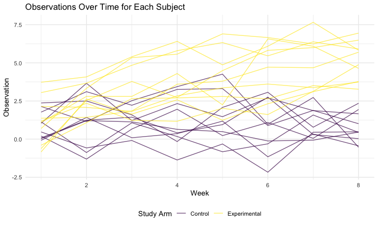

Homework 5
================

## Problem 2

``` r
study_df =
  tibble(
    file_name = list.files(path = "data", full.names = TRUE)
  ) |>
  mutate(
    data = map(file_name, read_csv, show_col_types = FALSE),
    base_name = tools::file_path_sans_ext(basename(file_name))
  ) |>
  separate(
    base_name,
    into = c("arm", "subject_id")
  ) |>
  unnest(data) |>
  pivot_longer(
    week_1:week_8,
    names_to = "week",
    names_prefix = "week_",
    values_to = "observation"
  ) |>
  mutate(
    week = as.numeric(week),
    subject_id = str_c(arm, "_", subject_id),
    arm = recode(arm, "con" = "Control", "exp" = "Experimental")
  ) |>
  select(subject_id, arm, week, observation)
```

``` r
study_df |>
  ggplot(aes(x = week, y = observation, group = subject_id, color = arm)) +
  geom_line(alpha = 0.7) +
  labs(
    x = "Week",
    y = "Observation",
    color = "Study Arm",
    title = "Observations Over Time for Each Subject"
  )
```



Both study arms have similar means around week 1 (about 0.9 in the
control arm and 1.1 in the experimental arm). The control group stays
flat with no clear trend over the 8 weeks, ending at about 0.7. The
experimental group rises steadily, reaching a mean of about 5.1 by week
8. By the end of the study, the two groups are clearly separated,
suggesting the treatment effect grows over time.
