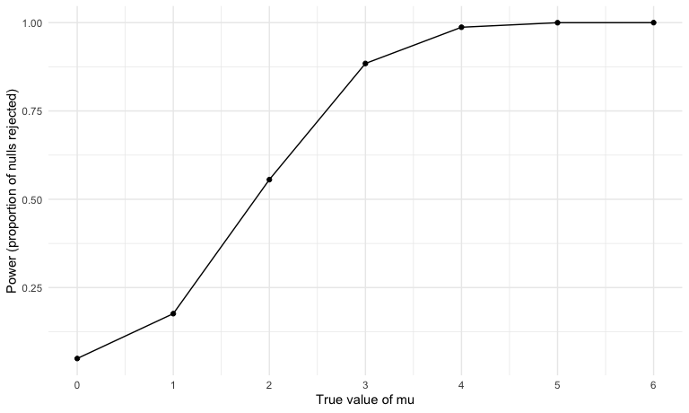
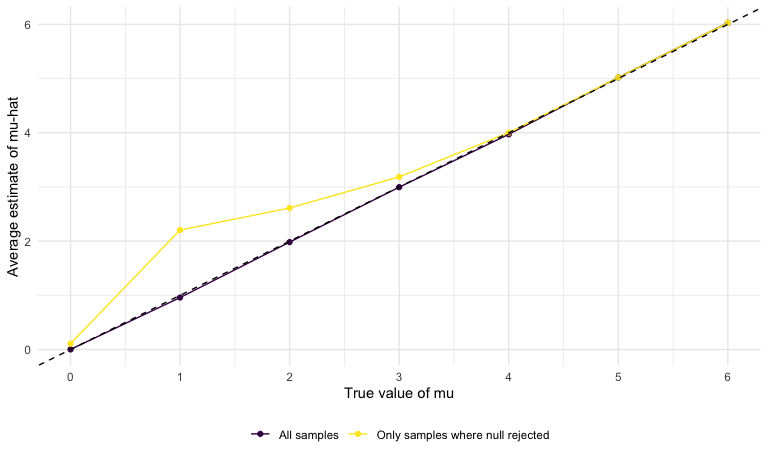

Homework 5
================

## Problem 2

``` r
study_df =
  tibble(
    file_name = list.files(path = "data", full.names = TRUE)
  ) |>
  mutate(
    data = map(file_name, read_csv, show_col_types = FALSE),
    base_name = tools::file_path_sans_ext(basename(file_name))
  ) |>
  separate(
    base_name,
    into = c("arm", "subject_id")
  ) |>
  unnest(data) |>
  pivot_longer(
    week_1:week_8,
    names_to = "week",
    names_prefix = "week_",
    values_to = "observation"
  ) |>
  mutate(
    week = as.numeric(week),
    subject_id = str_c(arm, "_", subject_id),
    arm = recode(arm, "con" = "Control", "exp" = "Experimental")
  ) |>
  select(subject_id, arm, week, observation)
```

### Spaghetti Plot

``` r
study_df |>
  ggplot(aes(x = week, y = observation, group = subject_id, color = arm)) +
  geom_line(alpha = 0.7) +
  labs(
    x = "Week",
    y = "Observation",
    color = "Study Arm",
    title = "Observations Over Time for Each Subject"
  )
```


Both study arms have similar means around week 1 (about 0.9 in the
control arm and 1.1 in the experimental arm). The control group stays
flat with no clear trend over the 8 weeks, ending at about 0.7. The
experimental group rises steadily, reaching a mean of about 5.1 by week
8. By the end of the study, the two groups are clearly separated,
suggesting the treatment effect grows over time.

## Problem 3

``` r
sim_t_test = function(mu, n = 30, sigma = 5) {
  x = rnorm(n, mean = mu, sd = sigma)
  t.test(x, mu = 0) |>
    broom::tidy() |>
    select(estimate, p.value)
}
```

``` r
power_results_df =
  expand_grid(
    mu = 0:6,
    iter = 1:5000
  ) |>
  mutate(
    result = map(mu, sim_t_test)
  ) |>
  unnest(result) |>
  mutate(reject = p.value < 0.05)
```

### Power Plot

``` r
power_summary_df =
  power_results_df |>
  group_by(mu) |>
  summarize(
    power = mean(reject),
    avg_estimate = mean(estimate),
    avg_estimate_rejected = mean(estimate[reject])
  )
```

``` r
power_summary_df |>
  ggplot(aes(x = mu, y = power)) +
  geom_point() +
  geom_line() +
  scale_x_continuous(breaks = 0:6) +
  labs(x = "True value of mu", y = "Power (proportion of nulls rejected)")
```



Power increases as the true value of μ gets larger. When the null is
true (μ = 0), the null was rejected in 0.049 of simulations, which is
close to the 0.05 significance level. Power rises to 0.18 at μ = 1, 0.56
at μ = 2, and 0.88 at μ = 3, and is essentially 1 by μ = 5. Larger
effects are further from the null relative to the standard error, so the
test is more likely to reject. The association is positive and S-shaped,
leveling off near 1.

### Estimate Plot

``` r
power_summary_df |>
  pivot_longer(
    avg_estimate:avg_estimate_rejected,
    names_to = "sample",
    values_to = "average_estimate"
  ) |>
  mutate(
    sample = recode(
      sample,
      avg_estimate = "All samples",
      avg_estimate_rejected = "Only samples where null rejected"
    )
  ) |>
  ggplot(aes(x = mu, y = average_estimate, color = sample)) +
  geom_point() +
  geom_line() +
  geom_abline(slope = 1, intercept = 0, linetype = "dashed") +
  scale_x_continuous(breaks = 0:6) +
  labs(
    x = "True value of mu",
    y = "Average estimate of mu-hat",
    color = NULL
  )
```



Across all simulated samples, the average estimate is very close to the
true value (e.g., 1.98 when μ = 2) because the sample mean is an
unbiased estimator. Among only the samples where the null was rejected,
the average estimate is 2.61 when μ = 2, and 2.21 when μ = 1 which is
larger than the true value. So the average of μ̂ among rejected tests is
not approximately equal to μ when power is low. This happens because
rejecting the null selects the samples whose estimates happened to be
far from 0, which inflates the average. When power is high, almost all
samples are rejected, so little is filtered out, and the two averages
agree. At μ = 5, the rejected-sample average is 5.02.
